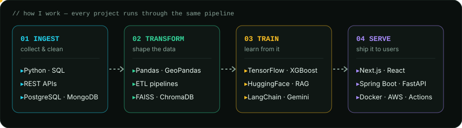

<a href="https://revanth-sai-2006.github.io/">portfolio</a> &nbsp;·&nbsp;
<a href="https://revanth-sai-2006.github.io/finverse-ai/">finVerse AI (live)</a> &nbsp;·&nbsp;
<a href="https://www.linkedin.com/in/revanth-sai-55b7b72a0">linkedin</a> &nbsp;·&nbsp;
<a href="mailto:2300031900@kluniversity.in">email</a>

 

I turn messy data into products people use: pipelines that clean it, models that learn from it, and apps that put the answer in someone's hand. Final-year B.Tech CSE (Data Engineering for AI) at KL University, CGPA 9.31, ex-AI Intern (LLM Developer) at Viswam.ai.

 

 

### `model_zoo/`

  
  
  
  

 

### `training_log/`

 

### `metrics/`

  
  

