<div align="center">


<a href="https://github.com/Revanth-sai-2006">
  
</a>

<br/>


<br/><br/>

<a href="https://revanth-sai-2006.github.io/"></a>
<a href="https://revanth-sai-2006.github.io/finverse-ai/"></a>
<a href="https://www.linkedin.com/in/revanth-sai-55b7b72a0"></a>
<a href="mailto:2300031900@kluniversity.in"></a>

<br/><br/>


</div>

<br/>



## About

I'm **Vedantam Revanth Sai**, a final-year B.Tech CSE (Data Engineering for AI) student at **KL University**. I build AI products end to end: data pipelines, models and LLM features, the APIs that serve them, and the interfaces people actually use.

- Spent a year as an **AI Intern (LLM Developer) at Viswam.ai**, shipping LLM features across 3 production deployments.
- Building **finVerse AI**, a live financial-planning platform with wealth forecasting, explainable scores and a Gemini-powered analyst.
- **Google Student Ambassador** at KL University: organised 5+ tech meetups, hackathons and workshops for 100+ students.

**Open to:** AI / Data Engineering, LLM application and full-stack roles.

## Tech Stack

<div align="center">

**Languages**


**AI / ML**


**Frontend**


**Backend & Databases**


**Cloud & DevOps**


</div>

## Featured Projects

<details open>
<summary><b>finVerse AI — Personal Financial Planning Platform</b> &nbsp;</summary>

<br/>

| | |
| :--- | :--- |
| **What** | A financial OS for Indian users: wealth forecasting, what-if simulator, explainable health score, spending anomaly detection, AI analyst |
| **Stack** | Next.js · React · TypeScript · Tailwind · Zoho Catalyst Serverless · Gemini API · Recharts |
| **ML** | LSTM cash-flow forecaster, XGBoost risk classifier and Isolation Forest, served from serverless functions |
| **Security** | scrypt password hashing, HMAC-signed sessions, cross-device cloud sync, DPDP-aligned privacy controls |
| **Extras** | Installable PWA, in-browser bank-statement import (CSV & PDF), IEEE-format research paper |
| **Live** | [revanth-sai-2006.github.io/finverse-ai](https://revanth-sai-2006.github.io/finverse-ai/) |

</details>

<details>
<summary><b>GigShield — AI Fraud Detection Platform</b></summary>

<br/>

| | |
| :--- | :--- |
| **Stack** | React · Node.js · Express · MongoDB · Python · scikit-learn · Docker · AWS |
| **Result** | ~92% precision on a 50K-record synthetic dataset; <200 ms average API response under load |
| **Features** | JWT + bcrypt auth, role-based dashboards, WebSocket real-time alerts, Stripe / Razorpay |
| **Repo** | [Revanth-sai-2006/gig_sheild](https://github.com/Revanth-sai-2006/gig_sheild) |

</details>

<details>
<summary><b>Disease Outbreak Detection System</b></summary>

<br/>

| | |
| :--- | :--- |
| **Stack** | Python · TensorFlow · XGBoost · FastAPI · React · GeoPandas · AWS |
| **Result** | Multi-model pipeline (LSTM, XGBoost, Isolation Forest) at 88% accuracy on WHO/CDC data, ~10K records a day |
| **Features** | Geographic risk heatmaps and alerts for 10+ diseases |
| **Repo** | [Revanth-sai-2006/Disease-Outbreak-Detection](https://github.com/Revanth-sai-2006/Disease-Outbreak-Detection) |

</details>

<details>
<summary><b>AI Timetable Generator</b></summary>

<br/>

| | |
| :--- | :--- |
| **Stack** | Python · Genetic Algorithms · Hill Climbing · Constraint Satisfaction |
| **Result** | 95% fewer timetable conflicts than manual scheduling across 3 departments, 50+ rooms and 100+ faculty |
| **Live** | [ai-time-table-generator-one.vercel.app](https://ai-time-table-generator-one.vercel.app) |
| **Repo** | [Revanth-sai-2006/AI-TIME-TABLE-GENERATOR](https://github.com/Revanth-sai-2006/AI-TIME-TABLE-GENERATOR) |

</details>

<details>
<summary><b>ProCare — Hospital Management System</b></summary>

<br/>

| | |
| :--- | :--- |
| **Stack** | Spring Boot · React · PostgreSQL · JWT · Swagger · Docker |
| **Features** | Role-based access for admin, doctor and patient; REST APIs documented with OpenAPI; automated PDF reports and email notifications |
| **Repo** | [Revanth-sai-2006/hms](https://github.com/Revanth-sai-2006/hms) |

</details>

## Experience

**AI Intern (LLM Developer)** &nbsp;·&nbsp; Viswam.ai &nbsp; `Jan 2024 – Dec 2024`

- Built and fine-tuned LLM applications with HuggingFace Transformers; ~30% better response relevance across 3 production deployments.
- Shipped AI features behind Flask + Docker REST services with a cross-functional team of 6.
- Data pipelines that cut prep time by ~40%; batching and caching that cut inference latency by 25%.

`LLMs` `HuggingFace` `Flask` `Docker` `Prompt Engineering`

<br/>

**Google Student Ambassador** &nbsp;·&nbsp; KL University &nbsp; `Aug 2025 – Present`

- Organised 5+ tech meetups, hackathons and workshops for 100+ participants.

`Community` `Events` `Google AI`

## Highlights

<div align="center">

| | |
| :--- | :--- |
| 🎓 **CGPA 9.31** | B.Tech CSE (Data Engineering for AI), KL University, Class of 2027 |
| 🧠 **150+ problems** | Solved on LeetCode and CodeChef (DSA, dynamic programming) |
| 📜 **MongoDB Associate Developer** | Node.js track |
| 🏦 **FinTech hackathon entry** | finVerse AI submitted to RBIH × St Aloysius FinTech Innovation Hackathon 2026 |
| 📄 **Research** | IEEE-format paper on explainable financial risk models for finVerse AI |

</div>

## GitHub Analytics

<div align="center">


</div>

## Contribution Snake

<div align="center">

<picture>
  <source media="(prefers-color-scheme: dark)" srcset="https://raw.githubusercontent.com/Revanth-sai-2006/Revanth-sai-2006/output/snake-dark.svg" />
  
</picture>

</div>

## Current Focus

```yaml
Building:
  - finVerse AI: goal planner, budgets and real-statement accuracy
Learning:
  - Production RAG and LLM evaluation
  - Data engineering at scale (pipelines, streaming, warehousing)
Open To:
  - AI / Data Engineering and LLM application roles
  - Full-stack product engineering
```

## Connect

<div align="center">

<a href="mailto:2300031900@kluniversity.in"></a>
<a href="https://www.linkedin.com/in/revanth-sai-55b7b72a0"></a>
<a href="https://revanth-sai-2006.github.io/"></a>

<br/><br/>

*Turning data into products people trust.*


</div>
